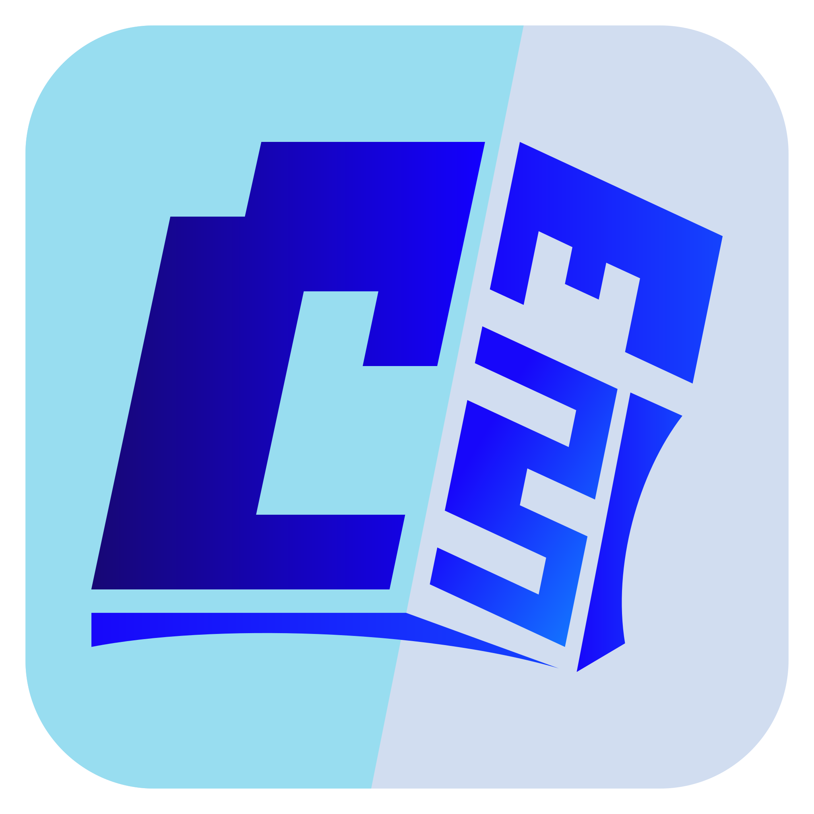
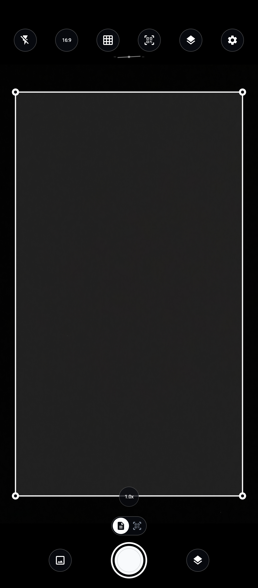
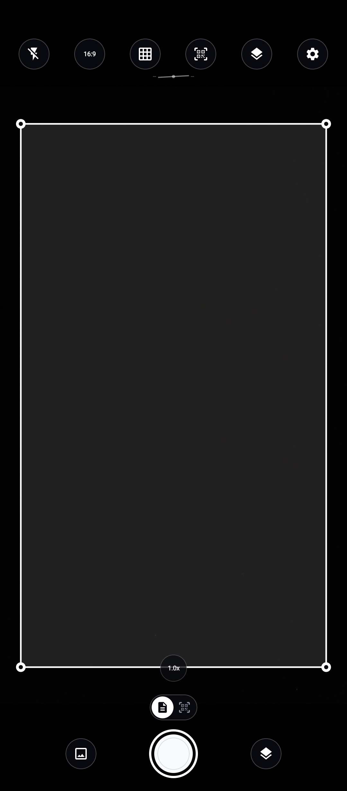
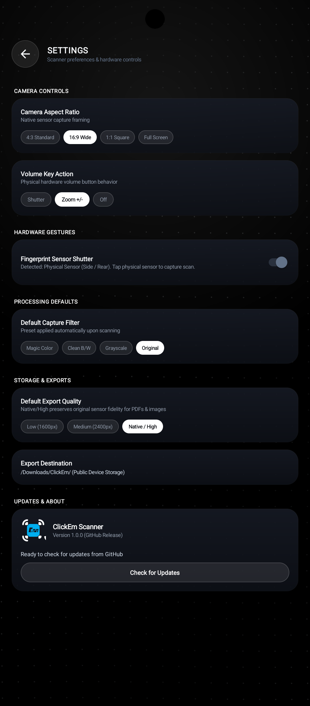
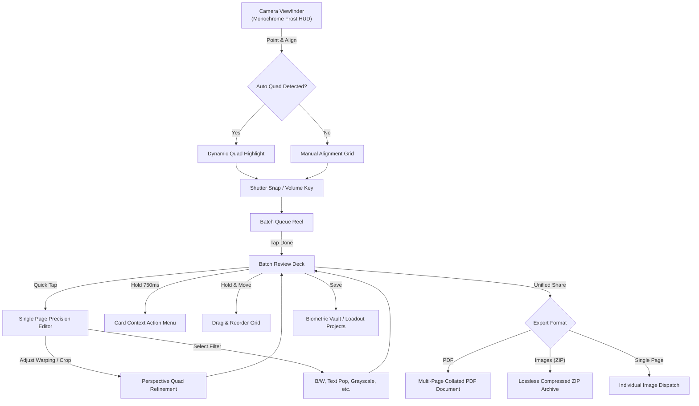

<div align="center">



# ClickEm

**An Intelligent, Edge-Accelerated Mobile Document Scanner & Processing Suite**

[](https://developer.android.com)
[](https://kotlinlang.org)
[](https://developer.android.com/training/camerax)
[](https://www.tensorflow.org/lite)
[](#design-philosophy--monochrome-frost)
[](LICENSE)

*Engineered by [31-Gallium](https://github.com/31-Gallium)*

</div>

---

## Executive Overview

**ClickEm** is an open-source, offline-first mobile document capture, edge computer-vision rectification, and multi-page document curation pipeline for Android. Crafted from the ground up in idiomatic Kotlin, ClickEm unifies high-performance camera streaming, hardware-accelerated homography quad transformations, neural boundary inference, and a distraction-free **Monochrome Frost** aesthetic.

Unlike conventional scanning utilities bloated with server telemetry, advertisements, and cloud lock-in, ClickEm operates strictly on-device, preserving user privacy with zero cloud dependencies and cryptographic biometric vault gating.

---

## Key Capabilities

- **Real-Time Edge Boundary Inference**: Dual-engine boundary detection combining custom-quantized TensorFlow Lite edge models with sub-millisecond OpenCV convex hull and geometric polygon refinement.
- **Perspective Homography Rectification**: Sub-pixel bilinear warp perspective transformations flattening skewed documents, receipts, and whiteboard captures into pristine orthographic planes.
- **Algorithmic Filter Processing**: Parameterized digital document enhancers including adaptive Sauvola binarization (Clean B/W), unsharp masking (Text Pop), luminance desaturation (Grayscale), and inverted dark-mode reading.
- **Hardware Shutter & Volume Interception**: Native hardware volume key policy orchestrating instant multi-burst capture or linear optical zoom while isolating third-party accessibility overlays.
- **Multi-Page Batch Sequencing**: Non-blocking `ItemTouchHelper` drag-reordering alongside a custom perimeter progress bar outline on card hold for contextual single-page actions.
- **Multi-Format Export Collation**: Production-grade PDF generation with parameterized page sizing and image compression, standalone ZIP archives, and direct single-page intent dispatching.
- **Zero-Latency Monochrome Frost UI**: Pure OLED pitch-black void backings (`#000000`), frosted acrylic HUD surfaces, specular rim strokes, dynamic system-notch clearances, and floating controls.

---

## User Guide & Interactive Workflow

ClickEm provides a streamlined, distraction-free workflow designed for speed, precision, and privacy. Below is an end-to-end visual walkthrough of the scanning process.

```
┌─────────────────┐       ┌─────────────────┐       ┌─────────────────┐       ┌─────────────────┐
│  1. Live Camera │ ────> │ 2. Batch Review │ ────> │  3. Page Editor │ ────> │  4. Share & PDF │
│  & Edge Capture │       │  & Reordering   │       │  & Perspective  │       │     Export      │
└─────────────────┘       └─────────────────┘       └─────────────────┘       └─────────────────┘
```

---

### 1. Viewfinder & Live Camera Controls

<div align="center">
  
</div>

The primary viewfinder operates in a full-screen, hardware-accelerated **Monochrome Frost** interface:

- **Top HUD Controls (Left to Right)**:
  - **Torch / Flash**: Toggles continuous torch illumination for low-light document scanning.
  - **Aspect Ratio Selector**: Cycles between `FULL`, `16:9`, `4:3`, and `1:1` framing modes.
  - **Grid Guides**: Toggles rule-of-thirds alignment grid lines across the live camera feed.
  - **Settings Gear**: Opens hardware preferences, biometric options, and the GitHub auto-update manager.
- **Scanning Mode Selector (Floating Pills)**:
  - **Document Mode**: Real-time neural edge detection, corner pin tracking, and automatic perspective rectification.
  - **QR / Barcode Mode**: Edge-accelerated Google ML Kit barcode decoding with instant clipboard extraction.
- **Bottom Floating Dock**:
  - **Gallery Import (Left)**: Import existing images or multi-page collections directly from device storage.
  - **Primary Shutter (Center)**: 72dp high-contrast capture trigger with animated feedback rings.
  - **Batch Review Badge (Right)**: Real-time counter displaying current session page count; tap anytime to enter the multi-page review deck.
- **Hardware Shortcuts**:
  - **Volume Keys**: Configurable in Settings for continuous optical zoom stepping (+0.4x per step) or hardware shutter trigger.
  - **Physical Fingerprint Shutter**: Tap your phone's physical side power-button or rear scanner to silently capture pages without moving or tapping the screen.

---

### 2. Viewport Aspect Ratio Framing

<div align="center">
  
</div>

- **Pitch-Black Masking**: Pure `#000000` OLED letterboxing completely masks extraneous sensor areas when framing in `16:9`, `4:3`, or `1:1`.
- **Full-Width Viewport**: The viewport dynamically consumes 100% of the display width in portrait orientation, providing maximum preview scale for documents, books, and receipts.
- **Edge Boundary Overlay**: Real-time corner reticles identify document corners and display tracking boundary guides.

---

### 3. Multi-Page Batch Review Deck

<div align="center">
  
</div>

After capturing one or more pages, tap the badge in the bottom-right corner to access the **Batch Review Deck**:

- **Header Bar**:
  - Displays the project document title (tap to rename) and total page count.
  - Tap the **Back Arrow** to immediately resume scanning more pages into the current project.
- **Page Grid & Drag Reordering**:
  - 2-column scrollable grid with frosted glass backing cards.
  - **Drag to Reorder**: Long-drag any page card to reposition it within your document sequence.
  - **Perimeter Hold Progress**: Press and hold any card for 750ms — an animated specular outline traces the card's perimeter before opening the contextual actions menu (**Retake In-Place**, **Rotate 90°**, **Duplicate**, **Delete**).
- **Single Page Navigation**: Tap any card to open the **Single-Page Fine-Tuning Editor**.
- **Unified "Share Document" Bar**: Floats cleanly above system 3-button or gesture navigation bars. Tap to collate and export all pages simultaneously.

---

### 4. Single-Page Fine-Tuning Editor

<div align="center">
  
</div>

Fine-tune colors, lighting, and clarity for each scanned page:

- **Top Action Bar**:
  - **Back Navigation**: Returns to the review grid with all edits safely preserved.
  - **Compare Badge**: Press and hold to momentarily preview the original unedited photo against your applied filter adjustments.
  - **Save Checkmark**: Commits all adjustments to project storage.
- **Bottom Navigation Dock**:
  - **In-Place Retake (Left Camera Icon)**: Re-photograph the current page directly if lighting or focus was imperfect, without losing its sequence in your project.
  - **Filters / Crop Segmented Dock (Center)**: Seamlessly toggle between color enhancement presets and geometric perspective correction.
  - **Reset Page (Right Restore Icon)**: Revert all filter parameters and crop points back to raw capture state.
- **Algorithmic Filter Presets**:
  - **Magic Color**: Balanced illumination normalization, dynamic color pop, and shadow reduction.
  - **Clean B/W**: Adaptive Sauvola binarization tuned for ultra-clean black-and-white text documents and forms.
  - **Text Pop**: Contrast-limited unsharp masking designed for low-contrast handwriting and invoices.
  - **Grayscale**: High-fidelity luminance desaturation.
  - **Dark Invert**: Dark-mode document inversion for reading comfort on OLED screens.
  - **Original**: Full-resolution raw camera sensor capture.

---

### 5. Interactive Perspective & Crop Quad

<div align="center">
  
</div>

- **8-Point Polygon Controls**: Drag the 4 corner handles and 4 midpoint handles to frame documents captured at extreme angles.
- **Sub-Pixel Bilinear Warping**: High-performance geometric perspective mapping transforms trapezoidal shapes into flat, square orthographic documents.
- **Rotation Affordances**: Rotate clockwise or counter-clockwise in 90° increments with instantaneous preview rendering.

---

### 6. Settings, Biometrics & GitHub Auto-Update

<div align="center">
  
  &nbsp;&nbsp;&nbsp;&nbsp;
  
</div>

Access comprehensive hardware, processing, and application management via the Settings screen:

- **Hardware Volume Action**: Toggle between linear optical zoom or instant burst capture for volume buttons.
- **Intelligent Biometric Sensor Detection**:
  - **Physical Sensors (Side Power Key / Rear)**: Automatically enabled for silent tactile capture gestures.
  - **Under-Display Sensors (In-Screen UDFPS / Optical)**: Automatically detected and disabled by default so on-screen viewfinder touches and UI taps are never hijacked or interrupted.
- **Export Resolution Defaults**: Choose between Low (1600px), Medium (2400px), or Native Full-Resolution capture pipelines.
- **GitHub Auto-Update System**:
  - Built directly into the app using ClickEm's native update engine (inspired by [31-Gallium/Yeval](https://github.com/31-Gallium/Yeval)).
  - Tap **"Check for Updates"** to query the latest releases from `31-Gallium/ClickEm`.
  - When an update is detected, download progress is reported in real time, and the native Android Package Installer is launched automatically via secure `FileProvider`.

---

## Architectural & Technical Deep Dive

### 1. Viewfinder & CameraX Ingestion Layer
ClickEm leverages the Android Jetpack **CameraX** subsystem configured with a decoupled `ImageAnalysis` and `ImageCapture` pipeline:
- **Zero-Shutter-Lag Ingestion**: Analysis frames are acquired in `YUV_420_888` planar format, piped to native memory, and evaluated asynchronously via a background executor thread without delaying preview rendering on the `PreviewView`.
- **Dynamic Geometric Viewporting**: The `ViewfinderOverlayView` mathematically derives aspect-ratio boundaries (`16:9`, `4:3`, `1:1`, and `FULL`) spanning 100% of the display width in portrait orientation while projecting pitch-black letterbox bands and specular boundary guides.

```
       [ CMOS Camera Sensor ]
                 │
                 ▼
     [ CameraX Frame Dispatcher ]
        ├── Preview Stream (SurfaceView / 60 FPS)
        └── ImageAnalysis Stream (YUV_420_888 @ 30 FPS)
                 │
                 ▼
      [ Boundary Analysis Pipeline ]
```

### 2. Dual-Engine Document Boundary Inference
Boundary detection uses a cascading failover architecture:
1. **Neural Path (`TfliteDocumentDetector.kt`)**: Analyzes downsampled image tensors through a lightweight neural detector tuned to isolate rectangular document hulls amidst complex backgrounds, textural grain, and oblique angles.
2. **Geometric Path (`BoundaryDetector.kt` & `DocumentDetector.kt`)**: Executes Gaussian spatial filtering, Canny edge detection, morphological dilation/erosion, and contour approximation via the Ramer–Douglas–Peucker algorithm to locate convex quadrilaterals with optimal aspect ratio and angular symmetry.
3. **Corner Pin Interpolation & Tracking**: The detected quadrilateral is tracked over temporal frames using an exponential moving average (EMA) smoother, suppressing jitter and rendering animated target nodes.

### 3. Perspective Warping & Homography Transformation
When capture triggers, [`PerspectiveWarper.kt`](app/src/main/java/com/clickem/scanner/util/cv/PerspectiveWarper.kt) computes a $3 \times 3$ perspective transformation matrix $M$ mapping the 4 arbitrary polygon corners $(x_i, y_i)$ to an orthographic rectangle:

$$
\begin{bmatrix}
x' \\
y' \\
1
\end{bmatrix}
\sim
M
\begin{bmatrix}
x \\
y \\
1
\end{bmatrix}
$$

The target image dimensions are determined from the Euclidean distances of the opposite quadrilateral edges, preserving the real document's native aspect ratio before performing bilinear interpolation.

### 4. Mathematical Filter Pipeline
The document image undergoes pixel-level transformations implemented in [`FilterManager.kt`](app/src/main/java/com/clickem/scanner/model/FilterMode.kt):
- **Clean B/W**: Adaptive dynamic thresholding separating foreground ink from non-uniform paper shadows.
- **Text Pop**: Combines contrast-limited adaptive histogram equalization (CLAHE) with a high-pass spatial kernel to maximize glyph sharpness while eliminating paper grain.
- **Grayscale**: Rec. 601 luma weighted summation:
  $$Y = 0.299R + 0.587G + 0.114B$$
- **Warm Note & Invert**: Color matrix remapping engineered for eye comfort during long reading sessions.

### 5. Multi-Page Batch Review Architecture
Batch curation is orchestrated by [`BatchReviewView.kt`](app/src/main/java/com/clickem/scanner/ui/batch/BatchReviewView.kt) and [`BatchGridAdapter.kt`](app/src/main/java/com/clickem/scanner/ui/batch/BatchGridAdapter.kt):
- **Perimeter Progress Bar Outline**: The custom `CardOutlineProgressView` calculates the card's rounded path via `PathMeasure`. Pressing down charges a glowing Frost White beam around the card perimeter over 750ms. Upon 100% completion, haptic feedback triggers the modal context menu.
- **Independent Drag Reordering**: Initiating movement after a 220ms hold threshold instantly cancels the context menu progress, passing control directly to `ItemTouchHelper` to fluidly drag and reposition pages across the grid without dialog interference.
- **Click Bleed-Through Prevention**: Overlay roots and layouts consume touch events explicitly (`isClickable = true`, `isFocusable = true`), while underlying camera view dispatching is gated by an active overlay flag to ensure zero phantom touches.

---

## User Workflow



1. **Capture**: Launch directly into the responsive live camera. Floating frosted acrylic controls provide instant toggling for flash, alignment grid, camera aspect ratio (`16:9`, `4:3`, `1:1`, `FULL`), and QR scanning.
2. **Review & Reorder**: Tap **Done** to enter the batch curation deck. Drag and drop any card to reorder pages; hold any card to watch the illuminated frost progress bar charge and open single-page tools (retake, rotate, crop, export).
3. **Fine-Tune & Enhance**: Open any page to interactively drag corner anchor nodes with sub-pixel precision and preview enhancement filters with live A/B comparison.
4. **Export & Archive**: Collate the scan into an optimized PDF or ZIP archive, or preserve it in the encrypted on-device Loadout vault protected by biometric authentication.

---

## Design Philosophy: Monochrome Frost

ClickEm rejects generic material design paradigms in favor of **Monochrome Frost**:
- **True OLED Pitch Black (`#000000`)**: Eliminates muddy dark-gray backgrounds, yielding maximum power efficiency and infinite visual depth.
- **Frosted Acrylic Translucency**: HUD pills, dock bars, and modal dialogs utilize layered gradients (`#E60C1018`, `#12151D`) complemented by crisp specular glass rim strokes (`#35FFFFFF`, `#45FFFFFF`).
- **Monochrome Typographic Hierarchy**: Pure high-contrast frost white (`#FFFFFF`) for primary actions and soft cool silver (`#CBD5E1`, `#8C96A5`) for secondary metadata.

---

## Project Structure

```
ClickEm/
├── app/
│   ├── src/
│   │   ├── main/
│   │   │   ├── java/com/clickem/scanner/
│   │   │   │   ├── ClickEmApplication.kt       # Application entry point & crash guard
│   │   │   │   ├── MainActivity.kt             # Backstack, window insets, lifecycle, biometric routing
│   │   │   │   ├── model/                      # Immutable data models & filter enums
│   │   │   │   │   ├── DocumentProject.kt      # Multi-page project schema & persistence
│   │   │   │   │   ├── FilterMode.kt           # Filter definition and tuning parameters
│   │   │   │   │   └── ScannedPage.kt          # Page metadata, rotation, and quad coordinate bounds
│   │   │   │   ├── ui/
│   │   │   │   │   ├── batch/                  # Batch review, card progress outline, drag reordering
│   │   │   │   │   ├── camera/                 # CameraX management, zoom, floating HUD, thumbnail dock
│   │   │   │   │   ├── components/             # Viewfinder overlay, manual crop canvas, grid backgrounds
│   │   │   │   │   ├── edit/                   # Single page editor, filter application, toolbars
│   │   │   │   │   ├── loadout/                # Project gallery, search, biometric vault
│   │   │   │   │   └── settings/               # Aspect ratio, volume key policies, storage preferences
│   │   │   │   └── util/
│   │   │   │       ├── cv/                     # TFLite detector, OpenCV quad homography, warping
│   │   │   │       ├── export/                 # PDF generator, ZIP collator, image exporter
│   │   │   │       ├── settings/               # Settings preferences & biometric manager
│   │   │   │       ├── storage/                # Scoped storage, thumbnail caching, file deletion
│   │   │   │       └── UiInsetsUtil.kt         # Frame-0 notch clearance & display cutouts
│   │   │   ├── res/                            # Vector drawables, monochrome layouts, styling
│   │   │   └── AndroidManifest.xml
│   │   └── test/                               # Comprehensive unit & regression test suites (81 tests)
│   └── build.gradle.kts
├── ClickEm.svg                                 # Vector brand identity & logo
├── ClickEm.png                                 # High-resolution raster brand emblem
├── LICENSE                                     # MIT License
└── README.md                                   # Documentation
```

---

## Building from Source

### Prerequisites
- **JDK 17** or **JDK 21**
- **Android SDK** (API Level 34 / Build Tools 34.0.0+)
- **Gradle 8.13+** (bundled via `gradlew`)

### Compilation & Testing
Clone the repository and run the Gradle verification pipeline:

```bash
# Clone the repository
git clone https://github.com/31-Gallium/ClickEm.git
cd ClickEm

# Execute full unit and regression test suite (81 tests)
./gradlew testDebugUnitTest

# Assemble debug APK
./gradlew assembleDebug

# Output APK path:
# app/build/outputs/apk/debug/app-debug.apk
```

---

## License

This project is licensed under the **MIT License**. See the [LICENSE](LICENSE) file for full legal terms.

```
Copyright (c) 2026 31-Gallium
```
