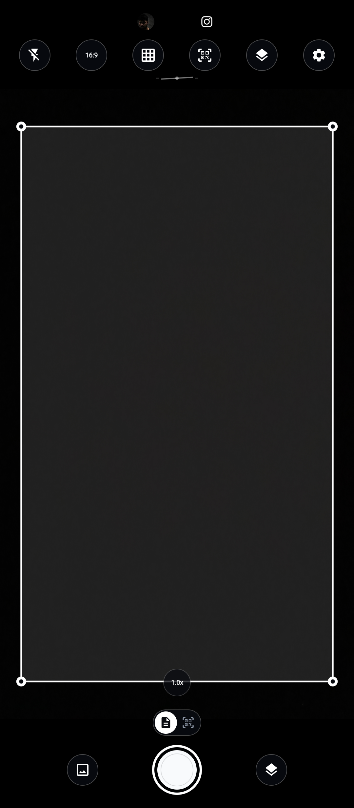
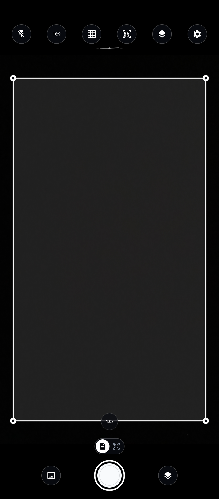
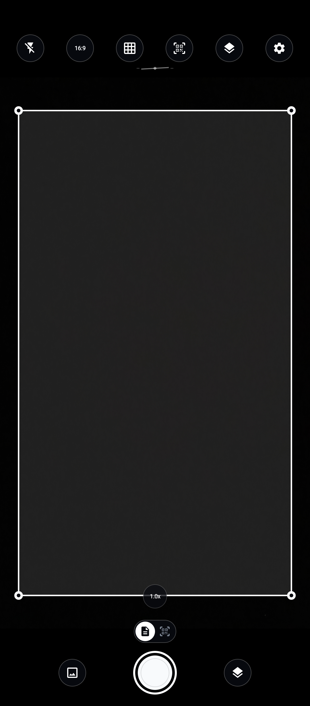
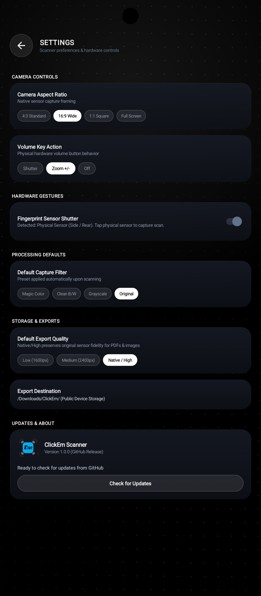
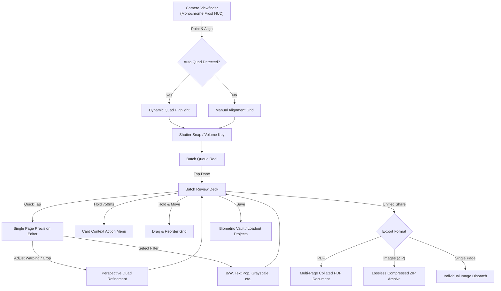

<div align="center">


# ClickEm

**A Clean, Fast & Privacy-Focused Mobile Document Scanner for Android**

[](https://developer.android.com)
[](https://kotlinlang.org)
[](https://developer.android.com/training/camerax)
[](#design-philosophy--monochrome-frost)
[](LICENSE)

*Created by [31-Gallium](https://github.com/31-Gallium)*

</div>

---

## About ClickEm

**ClickEm** is an open-source document scanner for Android designed to be fast, simple, and completely private.

Scan multi-page documents, receipts, contracts, and notes in seconds. ClickEm automatically detects paper boundaries, flattens tilted angles, sharpens faint text, and compiles multi-page PDFs ready to share—all entirely on your device with no ads, no trackers, and no internet connection required.

### Key Highlights
- ⚡ **Instant Document Detection**: Real-time corner detection captures clean, aligned pages without manual framing.
- 🔒 **100% Offline & Private**: Everything processes locally on your phone. No cloud servers, accounts, or telemetry.
- 📄 **Multi-Page PDF & Image Export**: Merge scans into collated PDFs, save them as high-res images, or stitch them into a continuous vertical image.
- 📁 **Custom Export Folder**: Choose exactly where your exported PDFs save on your internal storage or SD card.
- 🎛️ **Hardware Shortcuts**: Snap pages or zoom using your physical volume buttons or side fingerprint sensor.
- 🌑 **Monochrome Frost Theme**: Pure OLED pitch-black void with frosted glass controls designed for battery life and night comfort.

---

## User Guide: How to Scan & Create PDFs

Follow this simple step-by-step workflow to scan documents, arrange pages, and generate your PDFs:

```
┌─────────────────────────┐       ┌─────────────────────────┐       ┌─────────────────────────┐       ┌─────────────────────────┐
│     1. Point & Snap     │ ────> │   2. Review & Reorder   │ ────> │   3. Fine-Tune Pages    │ ────> │  4. Export to PDF/Share │
│   Camera auto-detects   │       │ Drag cards to sequence  │       │  Adjust corners/filters │       │ Save to folder or share │
└─────────────────────────┘       └─────────────────────────┘       └─────────────────────────┘       └─────────────────────────┘
```

---

### Step 1: Taking Scans with the Camera

<div align="center">
  
</div>

1. **Aim at your document**: Hold your phone over the paper, receipt, or book. ClickEm highlights the page boundaries with corner tracking guides.
2. **Snap the page**: Tap the circular white **Shutter** button in the center.
3. **Capture multiple pages**: Keep pointing and snapping! Each photo you take is immediately saved and counted in the bottom-right batch badge.
4. **Helpful camera controls**:
   - **Flash / Torch (Top Left)**: Turn on continuous illumination for scanning in dim environments.
   - **Aspect Ratio**: Tap the ratio pill to cycle between **Full Screen**, **16:9**, **4:3**, and **1:1**.
   - **Grid Lines**: Toggle rule-of-thirds grid lines for framing.
   - **Scan Modes (Pills above shutter)**: Switch between **Document** mode (page scanning) and **QR / Barcode** mode (instant barcode scanning).
5. **Hardware shortcuts**:
   - **Volume Buttons**: Press Volume Up/Down to zoom or trigger the shutter (configurable in Settings).
   - **Side Fingerprint Sensor**: If your phone has a physical side power-button or rear fingerprint sensor, simply touch it to take a photo silently without shaking the phone.

---

### Step 2: Framing & Aspect Ratio

<div align="center">
  
</div>

Choose the framing ratio that best fits your document:
- **Full Screen**: Uses the entire camera sensor preview.
- **16:9 & 4:3**: Standard document ratios with pitch-black letterbox masking for focused framing.
- **1:1 Square**: Perfect for square receipts, identity badges, or ID cards.

---

### Step 3: Reviewing & Reordering Pages

<div align="center">
  
</div>

When you have captured all your pages, tap the **batch counter button in the bottom-right corner** to open the **Review Deck**:

1. **View your document**: All scanned pages appear in a clean 2-column grid.
2. **Reorder pages**: Press and drag any page card to move it into the correct order.
3. **Quick actions**: Press and hold any card for a moment until the glowing border fills up. This opens a quick menu to:
   - **Retake In-Place**: Re-shoot that specific page if it came out blurry, without changing its page position.
   - **Rotate 90°**: Turn sideways pages right-side up.
   - **Duplicate**: Create a copy of the page.
   - **Delete**: Remove the page from the document.
4. **Add more pages**: Tap the **Back Arrow** at top-left anytime to return to the camera and keep scanning into the same document.

---

### Step 4: Fine-Tuning Crop & Enhancing Text

<div align="center">
  
</div>

Tap directly on any page thumbnail in the Review Deck to open the **Page Editor**:

1. **Choose a Document Filter**:
   - **Magic Color**: Restores natural colors while brightening dark shadows and paper yellowing.
   - **Clean B/W**: Turns handwritten notes and printed documents into crisp, high-contrast black-and-white.
   - **Text Pop**: Sharpens pencil and faint ink on invoices and receipts.
   - **Grayscale**: Converts photos and diagrams to smooth monochrome.
   - **Original**: Keeps the unedited camera capture.
2. **Compare Changes**: Press and hold the **Compare** badge at the top to see the original photo side-by-side with your edited version.
3. **Save**: Tap the checkmark to save your changes and return to the batch grid.

---

### Step 5: Adjusting Perspective & Cropping Corners

<div align="center">
  
</div>

If your document was photographed at an angle or on an uneven desk:

1. Tap **Crop / Perspective** in the Page Editor.
2. Drag the **4 corner circles** to line up with the four corners of your document.
3. ClickEm will straighten and flatten the document into a neat, rectangular page.
4. Use the rotation buttons to quickly turn the page 90° clockwise or counter-clockwise.

---

### Step 6: Creating & Sharing Your PDF

<div align="center">
  
</div>

Once your pages are reviewed and arranged:

1. Tap the **"Share Document"** button at the bottom of the Review Deck.
2. Select your desired format:
   - **PDF Document**: Generates a clean, multi-page PDF ready for work, school, or archival.
   - **Stitched Long Image**: Combines all pages into a continuous vertical image (ideal for long receipts or chat sharing).
   - **Individual Images (ZIP)**: Saves all pages as separate high-resolution JPEG files.
3. Type a title for your document and tap **Export**.
4. The Android share sheet opens automatically—send your PDF directly via Gmail, WhatsApp, Drive, Telegram, or print it wirelessly!
5. A copy is also saved to your device's export folder so you can access it anytime in your file manager.

---

### Step 7: Settings & Choosing Your Export Folder

<div align="center">
  
  &nbsp;&nbsp;&nbsp;&nbsp;
  
</div>

Tap the **Gear icon** in the top-right corner of the camera screen to open Settings:

- **Export Destination**: Tap **Browse** to choose any folder on your device or SD card where your scans and PDFs should be saved. Tap **Reset** anytime to restore the default `/Downloads/ClickEm/` folder.
- **Volume Key Behavior**: Choose whether volume keys zoom in/out or trigger the shutter.
- **Fingerprint Shutter**: Enable or disable shutter snapping via physical fingerprint sensors. (In-screen sensors are automatically disabled to prevent accidental screen taps).
- **Default Capture Filter**: Set your favorite filter (e.g. Magic Color or Clean B/W) to apply automatically to every new scan.
- **Default Export Quality**: Choose between High / Native, Medium (2400px), or Low (1600px) file sizes.
- **In-App GitHub Updates**: Tap **Check for Updates** to check for newer ClickEm releases directly from GitHub and install them with one tap.

---

## Architectural & Technical Deep Dive

### 1. Viewfinder & CameraX Ingestion Layer
ClickEm leverages the Android Jetpack **CameraX** subsystem configured with a decoupled `ImageAnalysis` and `ImageCapture` pipeline:
- **Zero-Shutter-Lag Ingestion**: Analysis frames are acquired in `YUV_420_888` planar format, piped to native memory, and evaluated asynchronously via a background executor thread without delaying preview rendering on the `PreviewView`.
- **Dynamic Geometric Viewporting**: The `ViewfinderOverlayView` mathematically derives aspect-ratio boundaries (`16:9`, `4:3`, `1:1`, and `FULL`) spanning 100% of the display width in portrait orientation while projecting pitch-black letterbox bands and specular boundary guides.

```
       [ CMOS Camera Sensor ]
                 │
                 ▼
     [ CameraX Frame Dispatcher ]
        ├── Preview Stream (SurfaceView / 60 FPS)
        └── ImageAnalysis Stream (YUV_420_888 @ 30 FPS)
                 │
                 ▼
      [ Boundary Analysis Pipeline ]
```

### 2. Dual-Engine Document Boundary Inference
Boundary detection uses a cascading failover architecture:
1. **Neural Path (`TfliteDocumentDetector.kt`)**: Analyzes downsampled image tensors through a lightweight neural detector tuned to isolate rectangular document hulls amidst complex backgrounds, textural grain, and oblique angles.
2. **Geometric Path (`BoundaryDetector.kt` & `DocumentDetector.kt`)**: Executes Gaussian spatial filtering, Canny edge detection, morphological dilation/erosion, and contour approximation via the Ramer–Douglas–Peucker algorithm to locate convex quadrilaterals with optimal aspect ratio and angular symmetry.
3. **Corner Pin Interpolation & Tracking**: The detected quadrilateral is tracked over temporal frames using an exponential moving average (EMA) smoother, suppressing jitter and rendering animated target nodes.

### 3. Perspective Warping & Homography Transformation
When capture triggers, [`PerspectiveWarper.kt`](app/src/main/java/com/clickem/scanner/util/cv/PerspectiveWarper.kt) computes a $3 \times 3$ perspective transformation matrix $M$ mapping the 4 arbitrary polygon corners $(x_i, y_i)$ to an orthographic rectangle:

$$
\begin{bmatrix}
x' \\
y' \\
1
\end{bmatrix}
\sim
M
\begin{bmatrix}
x \\
y \\
1
\end{bmatrix}
$$

The target image dimensions are determined from the Euclidean distances of the opposite quadrilateral edges, preserving the real document's native aspect ratio before performing bilinear interpolation.

### 4. Mathematical Filter Pipeline
The document image undergoes pixel-level transformations implemented in [`FilterManager.kt`](app/src/main/java/com/clickem/scanner/model/FilterMode.kt):
- **Clean B/W**: Adaptive dynamic thresholding separating foreground ink from non-uniform paper shadows.
- **Text Pop**: Combines contrast-limited adaptive histogram equalization (CLAHE) with a high-pass spatial kernel to maximize glyph sharpness while eliminating paper grain.
- **Grayscale**: Rec. 601 luma weighted summation:
  $$Y = 0.299R + 0.587G + 0.114B$$
- **Warm Note & Invert**: Color matrix remapping engineered for eye comfort during long reading sessions.

### 5. Multi-Page Batch Review Architecture
Batch curation is orchestrated by [`BatchReviewView.kt`](app/src/main/java/com/clickem/scanner/ui/batch/BatchReviewView.kt) and [`BatchGridAdapter.kt`](app/src/main/java/com/clickem/scanner/ui/batch/BatchGridAdapter.kt):
- **Perimeter Progress Bar Outline**: The custom `CardOutlineProgressView` calculates the card's rounded path via `PathMeasure`. Pressing down charges a glowing Frost White beam around the card perimeter over 750ms. Upon 100% completion, haptic feedback triggers the modal context menu.
- **Independent Drag Reordering**: Initiating movement after a 220ms hold threshold instantly cancels the context menu progress, passing control directly to `ItemTouchHelper` to fluidly drag and reposition pages across the grid without dialog interference.
- **Click Bleed-Through Prevention**: Overlay roots and layouts consume touch events explicitly (`isClickable = true`, `isFocusable = true`), while underlying camera view dispatching is gated by an active overlay flag to ensure zero phantom touches.

---

## User Workflow



1. **Capture**: Launch directly into the responsive live camera. Floating frosted acrylic controls provide instant toggling for flash, alignment grid, camera aspect ratio (`16:9`, `4:3`, `1:1`, `FULL`), and QR scanning.
2. **Review & Reorder**: Tap **Done** to enter the batch curation deck. Drag and drop any card to reorder pages; hold any card to watch the illuminated frost progress bar charge and open single-page tools (retake, rotate, crop, export).
3. **Fine-Tune & Enhance**: Open any page to interactively drag corner anchor nodes with sub-pixel precision and preview enhancement filters with live A/B comparison.
4. **Export & Archive**: Collate the scan into an optimized PDF or ZIP archive, or preserve it in the encrypted on-device Loadout vault protected by biometric authentication.

---

## Design Philosophy: Monochrome Frost

ClickEm rejects generic material design paradigms in favor of **Monochrome Frost**:
- **True OLED Pitch Black (`#000000`)**: Eliminates muddy dark-gray backgrounds, yielding maximum power efficiency and infinite visual depth.
- **Frosted Acrylic Translucency**: HUD pills, dock bars, and modal dialogs utilize layered gradients (`#E60C1018`, `#12151D`) complemented by crisp specular glass rim strokes (`#35FFFFFF`, `#45FFFFFF`).
- **Monochrome Typographic Hierarchy**: Pure high-contrast frost white (`#FFFFFF`) for primary actions and soft cool silver (`#CBD5E1`, `#8C96A5`) for secondary metadata.

---

## Project Structure

```
ClickEm/
├── app/
│   ├── src/
│   │   ├── main/
│   │   │   ├── java/com/clickem/scanner/
│   │   │   │   ├── ClickEmApplication.kt       # Application entry point & crash guard
│   │   │   │   ├── MainActivity.kt             # Backstack, window insets, lifecycle, biometric routing
│   │   │   │   ├── model/                      # Immutable data models & filter enums
│   │   │   │   │   ├── DocumentProject.kt      # Multi-page project schema & persistence
│   │   │   │   │   ├── FilterMode.kt           # Filter definition and tuning parameters
│   │   │   │   │   └── ScannedPage.kt          # Page metadata, rotation, and quad coordinate bounds
│   │   │   │   ├── ui/
│   │   │   │   │   ├── batch/                  # Batch review, card progress outline, drag reordering
│   │   │   │   │   ├── camera/                 # CameraX management, zoom, floating HUD, thumbnail dock
│   │   │   │   │   ├── components/             # Viewfinder overlay, manual crop canvas, grid backgrounds
│   │   │   │   │   ├── edit/                   # Single page editor, filter application, toolbars
│   │   │   │   │   ├── loadout/                # Project gallery, search, biometric vault
│   │   │   │   │   └── settings/               # Aspect ratio, volume key policies, storage preferences
│   │   │   │   └── util/
│   │   │   │       ├── cv/                     # TFLite detector, OpenCV quad homography, warping
│   │   │   │       ├── export/                 # PDF generator, ZIP collator, image exporter
│   │   │   │       ├── settings/               # Settings preferences & biometric manager
│   │   │   │       ├── storage/                # Scoped storage, thumbnail caching, file deletion
│   │   │   │       └── UiInsetsUtil.kt         # Frame-0 notch clearance & display cutouts
│   │   │   ├── res/                            # Vector drawables, monochrome layouts, styling
│   │   │   └── AndroidManifest.xml
│   │   └── test/                               # Comprehensive unit & regression test suites (81 tests)
│   └── build.gradle.kts
├── ClickEm.svg                                 # Vector brand identity & logo
├── ClickEm.png                                 # High-resolution raster brand emblem
├── LICENSE                                     # MIT License
└── README.md                                   # Documentation
```

---

## Building from Source

### Prerequisites
- **JDK 17** or **JDK 21**
- **Android SDK** (API Level 34 / Build Tools 34.0.0+)
- **Gradle 8.13+** (bundled via `gradlew`)

### Compilation & Testing
Clone the repository and run the Gradle verification pipeline:

```bash
# Clone the repository
git clone https://github.com/31-Gallium/ClickEm.git
cd ClickEm

# Execute full unit and regression test suite (81 tests)
./gradlew testDebugUnitTest

# Assemble debug APK
./gradlew assembleDebug

# Output APK path:
# app/build/outputs/apk/debug/app-debug.apk
```

---

## License

This project is licensed under the **MIT License**. See the [LICENSE](LICENSE) file for full legal terms.

```
Copyright (c) 2026 31-Gallium
```
